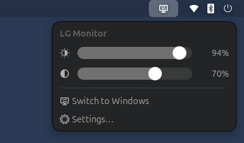
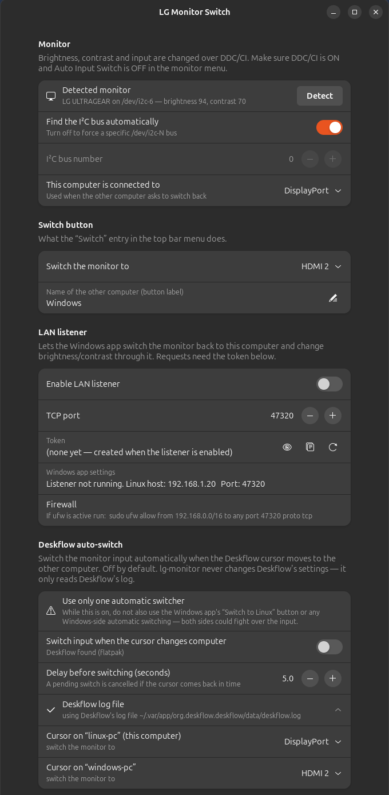

<p align="center"></p>

# LG Monitor Switch

Control an **LG UltraGear** monitor that is shared by two computers, from either computer:

- **Brightness** slider (VCP 0x10)
- **Contrast** slider (VCP 0x12)
- **Switch** button: flips the monitor input to the other computer

There is a GNOME top bar menu and a settings app for Linux, and a small tray app for Windows 11. An optional add-on
switches the input automatically when your [Deskflow](https://github.com/deskflow/deskflow) cursor moves to the
other computer.

| GNOME top bar menu | Linux settings app |
|---|---|
|  |  |

> Windows screenshot: not captured yet (the Windows app has not been run on real hardware so far, see
> [docs/WINDOWS_VERIFICATION_PROMPT.md](docs/WINDOWS_VERIFICATION_PROMPT.md)).

## Supported hardware

| | |
|---|---|
| Tested | **LG UltraGear 32GN650** (EDID `GSM` / "LG ULTRAGEAR", reports model GN600, MCCS 2.1) |
| Probably works | Other LG UltraGear / LG monitors that accept the LG `0xF4` input-select side channel (see [How it works](#how-it-works)) |
| Setup it was built for | Linux PC on **DisplayPort**, Windows 11 PC on **HDMI 2**. Both are configurable. |

Monitor OSD settings you need:

- **DDC/CI: On** (usually under *General*).
- **Auto Input Switch: Off**. Otherwise the monitor jumps back to whichever input has a signal.

## How it works

Brightness and contrast are standard MCCS VCP codes and work through
[ddcutil](https://www.ddcutil.com/) on Linux and the Win32 `dxva2` monitor API on Windows.

Input switching is harder. The standard way is VCP **0x60** (Input Source). The 32GN650 **accepts that command and
then ignores it**, and `getvcp 60` always reports DisplayPort-1 even when HDMI is on screen, so you can't use it to
find out the current input either.

The input switch that works is LG's manufacturer side channel. It is a normal DDC/CI *Set VCP Feature* packet for
register **0xF4**, sent with **source address 0x50** instead of the usual 0x51:

```
i2c write to 0x37:  50 84 03 F4 00 <input> <checksum>
                    │  │  │  │  └──┴─ value (hi, lo)
                    │  │  │  └─ register 0xF4 (LG input select)
                    │  │  └─ 0x03 = Set VCP Feature
                    │  └─ 0x80 | length 4
                    └─ source address 0x50 (LG side channel; standard is 0x51)
checksum = 0x6E XOR all preceding bytes   (0x6E = 0x37 << 1, the destination)

input: DisplayPort 1 = 0xD0, DisplayPort 2 = 0xD1, HDMI 1 = 0x90, HDMI 2 = 0x91
```

`ddcutil` 1.4 can't change the source address, so `lg-monitor` sends the packet with `i2ctransfer` (i2c-tools).
The Linux PC can send this packet **even while the monitor shows the other computer**: its I²C bus stays connected
over DisplayPort. That makes the round trip work:

- **Linux → Windows**: the Linux PC sends "HDMI 2".
- **Windows → Linux**: the Windows app asks the Linux PC over the LAN (the small, token-protected *LAN listener*),
  and the Linux PC sends "DisplayPort". Windows' DDC API can't set the source address 0x50 either, so this is the
  dependable route. See [docs/DDC_PROTOCOL.md](docs/DDC_PROTOCOL.md) for the alternatives.

**Safety:** the code only ever writes VCP 0x10, VCP 0x12 and the input switch. Writes to anything else (colour
preset, RGB gains, …) are refused in code, both on Linux (`WRITABLE_VCP`) and on Windows (`Ddc.SetVcp`).

Credits: the 0xF4 / source-0x50 trick and the input values come from
[MonitorInputWizzard](https://github.com/lunat1q/monitorinputwizzard) by lunat1q. Brightness and contrast use
[ddcutil](https://www.ddcutil.com/) by Sanford Rockowitz. Thank you both.

## Linux

Tested on Ubuntu 24.04, GNOME Shell 46 (X11). The extension declares GNOME 46–48.

### Install from the .deb (Ubuntu / Debian)

Download `lg-monitor-switch_<version>_all.deb` from the
[latest release](https://github.com/EntangledQuantum/lg-monitor-switch/releases/latest), then:

```bash
sudo apt install ./lg-monitor-switch_1.0.0_all.deb   # pulls in ddcutil, i2c-tools, GTK4/libadwaita
lg-monitor top-bar on                                  # as your normal user, not root
```

Restart GNOME Shell to see the top bar menu (X11: <kbd>Alt</kbd>+<kbd>F2</kbd>, `r`, <kbd>Enter</kbd>;
Wayland: log out and back in). The package installs to `/usr` and loads `i2c-dev` at boot. Your settings and
token stay per user in `~/.config/lg-monitor`. Remove it with `sudo apt remove lg-monitor-switch`.

If you previously used `install.sh`, run `linux/uninstall.sh` first so the copy in `~/.local` doesn't shadow the
packaged one. To build the package yourself: `packaging/build-deb.sh` (writes `dist/`).

### Install from source

```bash
sudo apt install ddcutil i2c-tools python3-gi gir1.2-adw-1   # if not installed yet
git clone https://github.com/EntangledQuantum/lg-monitor-switch.git
cd lg-monitor-switch/linux
./install.sh                    # or: ./install.sh --with-listener
```

The installer works without root. It installs:

| What | Where |
|---|---|
| `lg-monitor` CLI (Python stdlib, runs `ddcutil`/`i2ctransfer`) | `~/.local/bin/lg-monitor` |
| Settings app (GTK 4 / libadwaita) + `.desktop` + icon | `~/.local/bin/lg-monitor-settings`, `~/.local/share/applications/` |
| GNOME Shell extension (top bar menu) | `~/.local/share/gnome-shell/extensions/lg-monitor-switch@entangledquantum.github.io` |
| systemd user units (LAN listener, Deskflow watcher; both off by default) | `~/.config/systemd/user/` |
| Config | `~/.config/lg-monitor/config.ini` |

If something is missing, the installer prints the `sudo` commands for you to run:

- packages: `sudo apt install ddcutil i2c-tools`
- I²C device nodes: `sudo modprobe i2c-dev` and `echo i2c-dev | sudo tee /etc/modules-load.d/i2c-dev.conf`
- permission: `sudo usermod -aG i2c $USER`, then **log out and back in**. In a desktop session ddcutil's udev rule
  usually grants access already.

After a **first install**, GNOME Shell must load the new extension:
**X11:** press <kbd>Alt</kbd>+<kbd>F2</kbd>, type `r`, press <kbd>Enter</kbd>. **Wayland:** log out and back in.

### Use

- **Top bar** (monitor icon): Brightness and Contrast sliders (read from the monitor each time the menu opens;
  changes are written about 0.3 s after you stop dragging), **Switch to Windows**, and **Settings…**.
- **Settings app** ("LG Monitor Switch" in the app grid): autostart, monitor/bus, Switch target, LAN listener,
  Deskflow auto-switch.
- **CLI**:

```bash
lg-monitor get                    # brightness 94 / contrast 70   (--json for scripts)
lg-monitor set-brightness 60
lg-monitor set-contrast 70
lg-monitor switch                 # to the configured target (default hdmi2)
lg-monitor switch dp              # dp|dp1|dp2|hdmi1|hdmi2|home
lg-monitor detect                 # find the I2C bus (cached per login)
lg-monitor packet                 # print the raw switch packets, no I/O
lg-monitor service listener on    # LAN listener on/off (starts now and at login)
lg-monitor service deskflow on    # Deskflow auto-switch on/off
lg-monitor autostart [on|off]     # start enabled services at login; shows status
lg-monitor token [--regenerate]   # LAN listener token
lg-monitor deskflow-info          # what was detected about Deskflow (read-only)
```

### Autostart

Everything comes back on its own after you log in or reboot:

- The **top bar menu** is a GNOME Shell extension. Once enabled, GNOME loads it at every login.
- The background services are **systemd user units** (`WantedBy=default.target`), started when you log in:
  - `lg-monitor-listener.service`: LAN listener (if you turned it on)
  - `lg-monitor-deskflow.service`: Deskflow auto-switch (if you turned it on)

**Settings → Startup → "Start automatically at login"** is on by default. Turning it off disables those units
(`systemctl --user disable`); they keep running until you log out. Turning it on enables them again. **"Show in
the top bar"** turns the extension on or off. The CLI equivalents are `lg-monitor autostart on|off` and
`lg-monitor autostart` (status).

Check: `systemctl --user is-enabled lg-monitor-listener.service lg-monitor-deskflow.service`.

### Configuration

`~/.config/lg-monitor/config.ini` (the settings app edits it for you). It is fully documented in
[linux/config.example.ini](linux/config.example.ini). The main keys:

```ini
[general]
autostart = true          ; start enabled services at login
[monitor]
bus = auto                ; or a number, e.g. 6 for /dev/i2c-6
home_input = dp1          ; the input THIS computer uses
switch_target = hdmi2     ; where "Switch" sends the monitor
switch_target_name = Windows
[listener]
enabled = false
port = 47320
allow = private           ; only private/link-local/loopback clients
[deskflow]
enabled = false
delay = 5
[deskflow.screens]        ; Deskflow screen name = input
my-linux-pc = dp1
my-windows-pc = hdmi2
```

### LAN listener (lets Windows switch back to Linux)

Turn it on in the settings app, or run `lg-monitor service listener on` (or `./install.sh --with-listener`).
It is a ~100-line Python `http.server` running as your user:

- listens on `0.0.0.0:47320` (configurable);
- every request needs `Authorization: Bearer <token>`. The token is 32 random characters in
  `~/.config/lg-monitor/token` (mode 600), created on first use. Show it with `lg-monitor token`; regenerate it in
  the settings app or with `lg-monitor token --regenerate`;
- only accepts clients from private/link-local/loopback addresses by default (`allow = private`);
- fixed allow-list of actions: `GET /v1/ping`, `GET /v1/status`, `POST /v1/brightness {"value":0-100}`,
  `POST /v1/contrast {"value":0-100}`, `POST /v1/switch {"input":"home|dp1|dp2|hdmi1|hdmi2"}`. Nothing else, and
  no way to write other VCP codes. Values are range-checked, bodies are limited to 256 bytes, and a wrong token
  costs 0.5 s;
- plain HTTP. The token travels unencrypted on your LAN, so use it only on a network you trust.

Firewall: Ubuntu's `ufw` is off by default. If you turned it on, allow the port from your LAN only:

```bash
sudo ufw allow from 192.168.0.0/16 to any port 47320 proto tcp
```

Test from another computer: `curl -H "Authorization: Bearer <token>" http://<linux-ip>:47320/v1/ping`.

### Deskflow auto-switch (optional, off by default)

If [Deskflow](https://github.com/deskflow/deskflow) is installed (native or Flatpak), the settings app offers
**"Switch input when the cursor changes computer"**:

1. When the Deskflow cursor moves to another screen, a timer starts (default **5 s**).
2. If the cursor comes back before the timer runs out, nothing happens. Otherwise the monitor switches to the input
   you mapped to that screen.
3. When the cursor returns to the Linux screen, the monitor switches back the same way.

lg-monitor **never changes Deskflow's settings**. It only reads Deskflow's log, where the Deskflow server writes
lines like `switch from "linux-pc" to "windows-pc" at 1919,540`. Deskflow's **Log to file** option has to be on,
and you need to turn it on yourself:

1. Deskflow → **Settings**. In the *Log* section tick **Log to file** and keep the level at *Info* or higher.
2. Set the log path. For the **Flatpak** version use
   `~/.var/app/org.deskflow.deskflow/data/deskflow.log` (written as a full path, e.g. `/home/you/.var/...`).
   The Flatpak sandbox can't write elsewhere in your home folder. For a native install any path works,
   e.g. `~/deskflow.log`.
3. Press OK, then stop and start the Deskflow server once.

The settings app shows whether the log file was found and lets you map each Deskflow screen to an input.

> **⚠ Use only one automatic switcher.** While Deskflow auto-switch is on, do **not** also use the Windows app's
> "Switch to Linux" button or any Windows-side automatic switching. Both sides could fight over the input. Manual
> switches from the Linux top bar are fine: the watcher notices them.

## Windows 11

`windows/LGMonitor.ps1` is a **single PowerShell + WinForms script**: a small window plus a tray icon with
Brightness and Contrast sliders and a **Switch to Linux** button.

Why PowerShell? It needs **nothing to install or build**: Windows PowerShell 5.1, .NET Framework and WinForms
ship with every Windows 11. You can read the whole program before running it. The small Win32 DDC wrapper is C#
source compiled on the fly by `Add-Type`. A compiled .exe would need a toolchain or an unsigned binary download,
and SmartScreen warns about both.

### Install

1. Get the repo (`git clone https://github.com/EntangledQuantum/lg-monitor-switch.git`, or *Code → Download ZIP*
   and extract).
2. In PowerShell, in the `windows` folder:
   ```powershell
   powershell -NoProfile -ExecutionPolicy Bypass -File .\Install-LGMonitor.ps1 -Startup
   ```
   This copies the app to `%LOCALAPPDATA%\LGMonitor` and creates a Start menu shortcut. `-Startup` also starts it
   at login as a tray icon. It doesn't need admin rights. To remove it, run the same script with `-Uninstall`.
3. On Linux, enable the LAN listener and copy the token: `lg-monitor service listener on && lg-monitor token`.
4. Open **LG Monitor Switch** → **Settings…** → enter the Linux PC's IP, port `47320` and the token →
   **Test connection** → **Save**.

To run without installing: `powershell -NoProfile -ExecutionPolicy Bypass -File .\LGMonitor.ps1`.

### How it controls the monitor

- **Brightness/contrast**: DDC/CI from Windows directly (`dxva2.dll` `GetPhysicalMonitorsFromHMONITOR` +
  `Get/SetVCPFeature`). The LG monitor is picked automatically (EDID id `GSM`), or set `monitor_index`
  (see `-ListMonitors`). Optionally send them through the Linux listener instead (`brightness_via = linux`).
- **Switch to Linux**: `POST /v1/switch` to the Linux listener, which sends the LG packet.
- Optional `switch_method = ddc60`: the standard `SetVCPFeature(0x60, 0x0F)`. It's there for other monitors; the
  32GN650 ignores it.
- Advanced: on NVIDIA GPUs, NVAPI's raw I²C functions *can* send the 0x50/0xF4 packet straight from Windows (that is
  how MonitorInputWizzard does it). This app doesn't implement that. Use MonitorInputWizzard if you need
  Windows-only switching.
- There's no "Switch to Windows" button on Windows: it would make no sense there.
- **Planned, not implemented:** Deskflow auto-switch on Windows. See the warning above about running only one
  automatic switcher.

Command-line mode (handy for testing):

```powershell
.\LGMonitor.ps1 -ListMonitors
.\LGMonitor.ps1 -Get
.\LGMonitor.ps1 -SetBrightness 60
.\LGMonitor.ps1 -TestLinux
.\LGMonitor.ps1 -SwitchToLinux
.\LGMonitor.ps1 -Configure -LinuxHost 192.168.1.20 -Token <token>
```

Config: `%APPDATA%\LGMonitor\config.json` (see [windows/config.example.json](windows/config.example.json)).
It contains the token, so don't share it.

## Troubleshooting

| Problem | Fix |
|---|---|
| `monitor … not found by 'ddcutil detect'` | Turn on DDC/CI in the monitor OSD. Check `ls /dev/i2c-*` (otherwise `sudo modprobe i2c-dev`) and `ddcutil detect`. |
| Permission denied on `/dev/i2c-N` | `sudo usermod -aG i2c $USER`, then log out and back in. |
| Wrong monitor / several monitors | Set `bus = N` (Linux) or `monitor_index` (Windows, see `-ListMonitors`). |
| Switch does nothing | Turn **Auto Input Switch** off in the OSD. Check that the other input really is HDMI 2 (or change `switch_target`). Run `lg-monitor switch hdmi2` and watch for errors. |
| The screen comes back by itself after switching | **Auto Input Switch** is on, or the other computer is asleep and sends no signal. |
| Top bar icon missing after install | X11: <kbd>Alt</kbd>+<kbd>F2</kbd> `r`; Wayland: log out/in. Check `gnome-extensions info lg-monitor-switch@entangledquantum.github.io`. |
| Slider changes don't stick | DDC/CI is slow and the monitor sometimes drops a write; `lg-monitor` checks each write and retries. Try `lg-monitor set-brightness 50` to see the error. |
| Windows: "Linux listener … unable to connect" | Is the listener running (`systemctl --user status lg-monitor-listener`)? Firewall (`ufw`)? Right IP and port? Same LAN? |
| Windows: 401 | The token doesn't match. Copy `lg-monitor token` again. |
| Windows: `DDC/CI read … failed` | Pick the right monitor (`-ListMonitors`), turn on DDC/CI in the OSD, try another cable/port. Some docks/KVMs block DDC. |
| Deskflow auto-switch never fires | Settings app → Deskflow log file row. Turn on *Log to file* in Deskflow (path inside `~/.var/app/org.deskflow.deskflow/` for Flatpak), check the screen mapping, and watch `journalctl --user -u lg-monitor-deskflow -f`. |

## Development

```bash
/usr/bin/python3 -m unittest discover -s tests -v        # no hardware access
node --check linux/extension/*/extension.js
tests/shell-harness/run-headless.sh /tmp/out              # headless GNOME Shell: loads the extension, screenshots
```

Technical notes: [docs/DDC_PROTOCOL.md](docs/DDC_PROTOCOL.md). Hardware test log: [docs/TEST_LOG.md](docs/TEST_LOG.md).

## More monitors and contributing

Only the **LG UltraGear 32GN650** has been tested so far. If you'd like support for another monitor,
[open an issue](https://github.com/EntangledQuantum/lg-monitor-switch/issues/new) with:

- the monitor model (from the sticker on the back or the OSD *Information* page),
- the output of `ddcutil detect` and `ddcutil capabilities` (remove the serial number if you like),
- which inputs your computers use (DisplayPort / HDMI 1 / HDMI 2 / USB-C),
- whether `lg-monitor switch <input>` works, and what happens on screen.

New models will be added as reports come in. Pull requests are very welcome too: input codes for other monitors,
other desktops (KDE, Cinnamon, …), packaging, the Windows app, translations. Please keep the safety rule: only
write brightness, contrast and the input switch. Run `/usr/bin/python3 -m unittest discover -s tests` before
sending a PR.

## License

[MIT](LICENSE). Not affiliated with LG Electronics or the Deskflow project.
